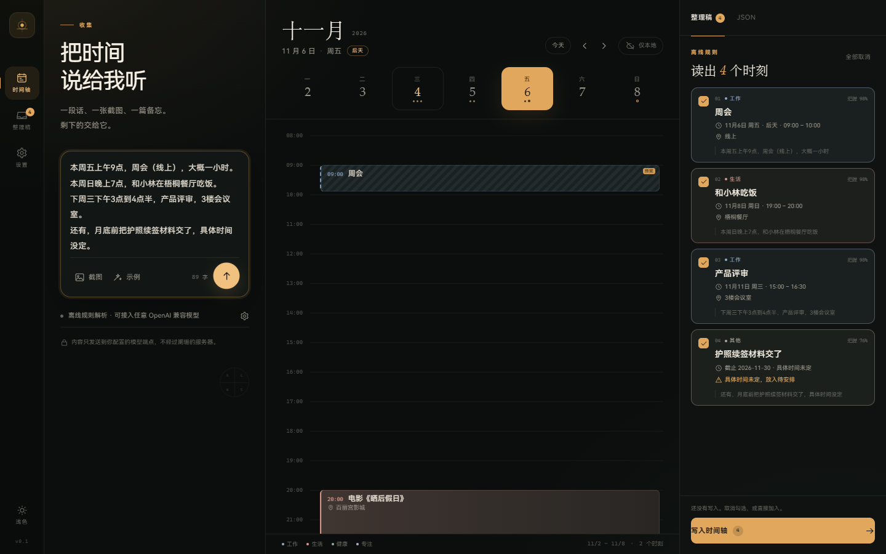
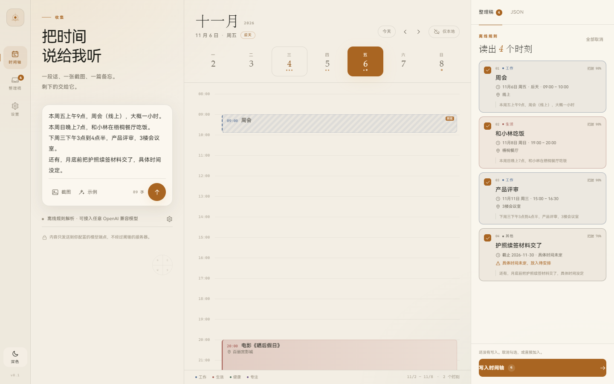
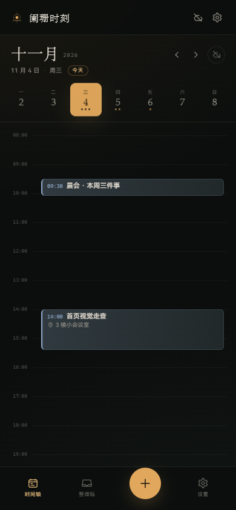
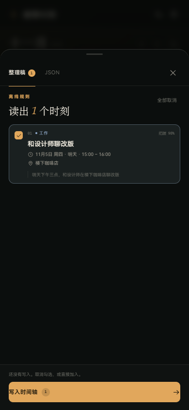
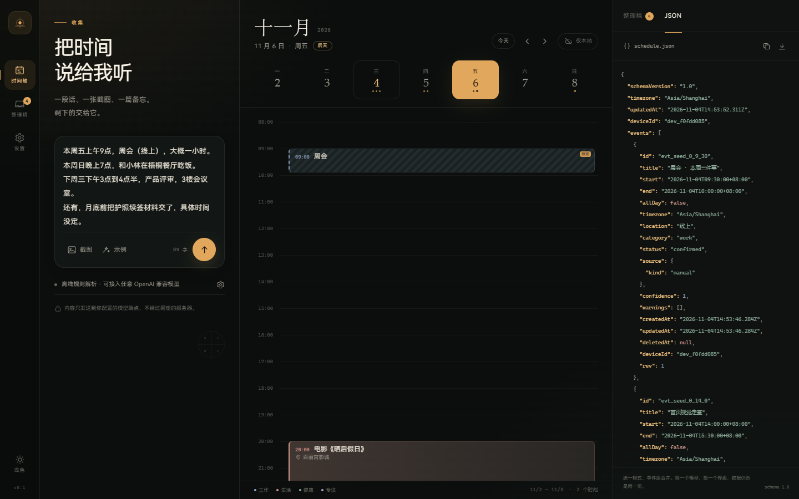

# 阑珊时刻 · Lanshan Moments

> 把散落的时间，收拢成一条看得见的光带。  
> 一段话、一张截图、一篇备忘 → AI 整理成统一日程 JSON → 落在时间轴上。



**当前状态：v0.1 可行性 Demo。** 这不是一个已经完成的产品，而是一个可以运行、可以点击、可以验证核心体验的原型。正式版会使用 SQLite、原生通知/小组件、系统钥匙串，并把同步做成可选增强。

技术判断、排期与风险见 [可行性分析](./docs/feasibility.md)；界面与交互取舍见 [前端设计讨论](./docs/frontend-design.md)；数据协议见 [数据模型](./docs/data-model.md)。

---

## 它解决什么

时间信息通常不是日历条目的形状：

- 群里的一段通知
- 一张课程表/会议截图
- 文章里的一句“月底前交材料”
- 语音转文字后的一团文本

现有日历要求你先想清楚标题、开始、结束、提醒，再手动录入。阑珊时刻把顺序反过来：

1. **先丢进来**：文字、图片、拖拽、粘贴。
2. **AI 出草稿**：拆出多个事件，保留原文片段，标出不确定处。
3. **你确认**：逐条勾选/取消；低置信度不偷偷写入。
4. **写入时间轴**：日/周视图、当前时间线、待安排。
5. **同步到自己的 GitHub 私有仓库**：零服务器，本地优先。

设计原则只有一条：**AI 是编辑，不是权威。**

---

## 现在能做什么

- ✅ 中文文本解析：相对日期（本周五/下周三）、时间范围（下午 3 点到 4 点半）、地点、时长、截止日期、待安排
- ✅ 图片入口：拖拽/粘贴/选择；配置视觉模型后随文字一起发给模型（未配置时会明确提示）
- ✅ AI 接口：任意 OpenAI Chat Completions 兼容端点（DeepSeek / OpenAI / 通义 / Ollama 等），BYOK
- ✅ 无 Key 也能用：内置离线规则解析，保证 Demo 可演示
- ✅ 整理稿：置信度、警告、原文引用、逐条勾选、批量写入、撤销
- ✅ 时间轴：日视图 + 周条、重叠列、当前时间线、待安排、事件详情、软删除
- ✅ JSON：`schedule.json` 实时预览、复制、下载、导入/导出
- ✅ GitHub 同步：私有仓库 + fine-grained PAT，事件级合并、墓碑、SHA 冲突重试
- ✅ 深/浅主题、桌面四栏、移动端抽屉与底部导航
- ✅ PWA manifest + 离线 shell 缓存（生产构建）
- ✅ 响应式 + 键盘快捷键（`N` 聚焦录入，`Ctrl/Cmd + Enter` 解析，`Esc` 关闭）

### 刻意没做

- ❌ 原生通知 / 桌面小组件 / 精确闹钟（需要 Tauri/Capacitor 壳）
- ❌ 真实 OCR 兜底、复杂表格/手写识别
- ❌ 重复事件、拖拽改期、时区选择器
- ❌ E2EE、团队协作、系统日历双向同步
- ❌ iOS/macOS/HarmonyOS 上架

这些不是遗漏，而是为了先验证“录入 → 确认 → 时间轴”这条主链路。

---

## 快速开始

需要 Node.js 22+（开发时使用 Node 24）。

```bash
npm install
npm run dev
# http://localhost:5173
```

生产构建：

```bash
npm run build
npm run preview
```

### 不配置任何 Key 的演示路径

1. 打开页面，点击输入框下方的「示例」。
2. 点右下角圆形「↑」。
3. 右侧出现 4 条草稿：周会、和小林吃饭、产品评审、护照续签（待安排）。
4. 取消/勾选任意条目，点「写入时间轴」。
5. 切到「JSON」看统一格式；点事件打开详情；试试删除后“撤销”。

示例文本是动态相对日期（本周五/下周三/月底），所以换一天运行也不会全是过去时间。

### 配置 AI

设置 → 模型接口：

- 接口地址：例如 `https://api.deepseek.com/v1`
- 模型：例如 `deepseek-chat`
- API Key：只保存在本次会话（`sessionStorage`）

图片输入需要支持视觉的模型（例如 `gpt-4o-mini`、`qwen-vl-max`）。若浏览器直连遇到 CORS，请换桌面端/自建代理；公开 Demo 不内置任何厂商密钥。

想试图片路径，可以拖入 [这张示例图](./docs/assets/sample-schedule-image.png)；它和示例文本表达的是同一组安排。

> 安全提示：这是原型。生产版会把 Key 放进系统钥匙串，并通过原生 HTTP 发起请求。不要把真实 Key 提交到仓库。

### 配置 GitHub 同步

1. 新建一个 **私有** 仓库（例如 `lanshan-schedule`）。
2. 创建 [fine-grained PAT](https://github.com/settings/personal-access-tokens/new)，只勾选该仓库的 **Contents: Read and write**。
3. 设置 → 多设备同步：填用户名、仓库名、分支、Token。
4. 点「验证并同步」。首次会创建 `schedule.json`；另一台设备填同样的仓库/Token，再同步。

同步是事件级合并，不是“远端覆盖本地”。删除使用墓碑；冲突会重拉、合并、重试。完整协议见 [data-model.md](./docs/data-model.md)。

### 发布 Demo 到 GitHub Pages

1. 把仓库推到 GitHub（公开仓库）。
2. Settings → Pages → Source 选 **GitHub Actions**。
3. push 到 `main` 后，[deploy.yml](./.github/workflows/deploy.yml) 会构建并发布 `dist/`。
4. 打开 `https://<user>.github.io/<repo>/`。Vite 使用相对路径，子路径部署不需要改配置。

---

## 界面

| 桌面 · 深色 | 桌面 · 浅色 |
|---|---|
|  |  |

| 移动端 · 时间轴 | 移动端 · 核对 |
|---|---|
|  |  |

JSON 视图：



---

## 技术栈

| 层 | Demo | 生产建议 |
|---|---|---|
| UI | React 19 + TypeScript + Vite 8 | 保持；或按团队偏好换 Preact/Solid |
| 样式 | 原生 CSS + design tokens | 保持；不引入重型 UI 框架 |
| 本地存储 | localStorage | IndexedDB（PWA）/ SQLite（原生） |
| AI | OpenAI Chat Completions 兼容接口，BYOK | 原生 HTTP + 系统钥匙串；可选代理 |
| 同步 | GitHub Contents API，单 `schedule.json` | 事件级合并；量大后按月分片 / Git Data API |
| 桌面 | — | Tauri 2（Windows/macOS） |
| Android/iOS | — | Capacitor 8 + Kotlin/Swift 插件 |
| HarmonyOS | — | 先 PWA；后 ArkTS 壳 |

```
.
├── docs/                 # 可行性、设计、数据模型
├── public/               # favicon / manifest
├── schema/               # 统一日程 JSON Schema
├── src/
│   ├── components/       # Capture / Timeline / Inspector / Settings / EventDialog
│   ├── lib/              # ai / parser / date / sync / storage
│   ├── App.tsx
│   ├── index.css         # design tokens + 布局
│   └── types.ts
└── .github/workflows/    # GitHub Pages 部署
```

---

## 路线图

| 版本 | 目标 |
|---|---|
| v0.1（当前） | 可行性 Demo：文本/图片 → 草稿 → 时间轴 → JSON → GitHub 同步 |
| v0.2 | Windows（Tauri）+ Android（Capacitor）壳；本地 SQLite；通知；系统钥匙串 |
| v0.3 | GitHub 同步打磨（E2EE 可选、冲突 UI、月分片）；离线队列；导入/导出 |
| v0.4 | Android 桌面小组件 + 精确闹钟；iOS WidgetKit；移动端分享入口 |
| v1.0 | 上架/签名、引导、隐私政策、无障碍、英文界面；评估 WebDAV/S3 |

细节和决策门槛见 [可行性分析](./docs/feasibility.md)。

---

## 安全与隐私

- 公开仓库不包含任何真实日程、Token、API Key；示例数据全部虚构。
- Demo 的 API Key 与 GitHub Token 只放 `sessionStorage`，关闭标签页即清除。
- 生产版使用 fine-grained PAT（仅 Contents R/W）与系统钥匙串。
- 同步是可选的；默认体验是单机可用。没有“必须登录”的墙。
- 日程是敏感数据。是否启用 E2EE、是否把原文发给模型，必须由用户明确选择。

---

## 参与

这是一个早期项目，欢迎从这些问题开始讨论：

- GitHub 私有仓库作为同步方式，对首批用户是否太重？
- 默认视图应该是“今天”还是“本周”？
- 哪些重复事件/系统日历场景是必须进 1.0 的？
- Android 小组件、精确闹钟、iOS WidgetKit，哪个先做？

提交 Issue 前请先读 [可行性分析](./docs/feasibility.md) 的“非目标”和 [前端设计讨论](./docs/frontend-design.md) 的开放问题。

---

## License

[MIT](./LICENSE)
