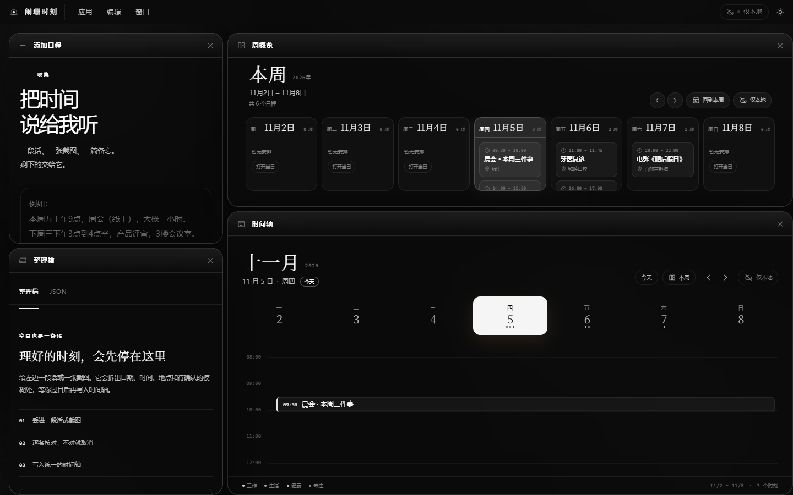
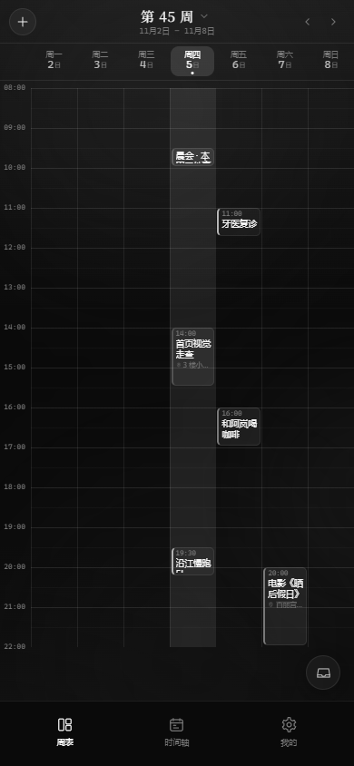
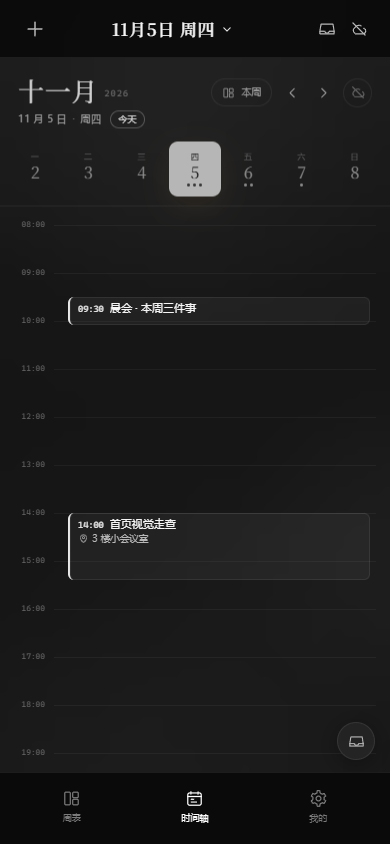
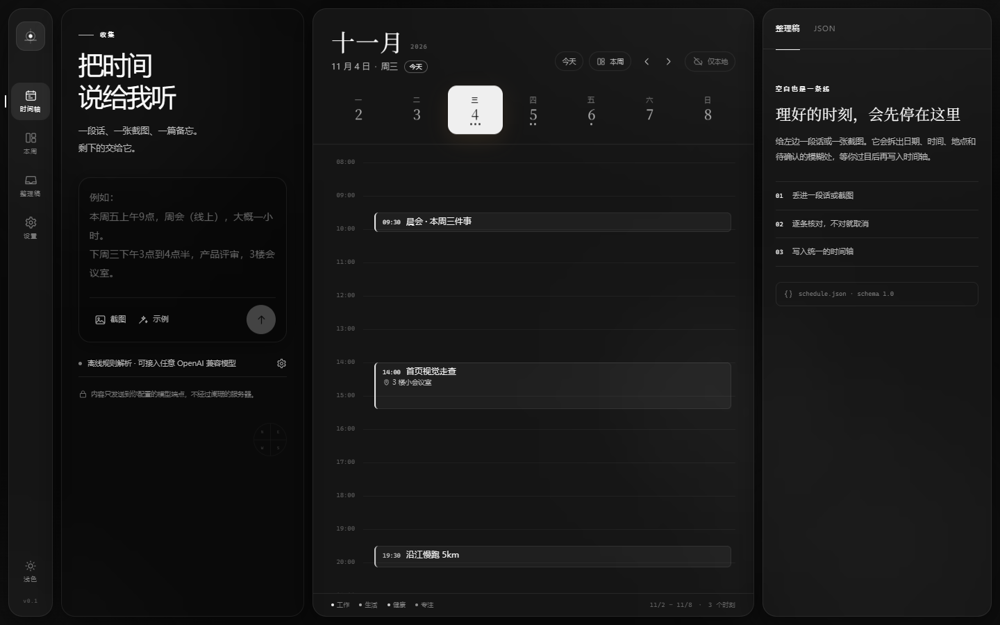
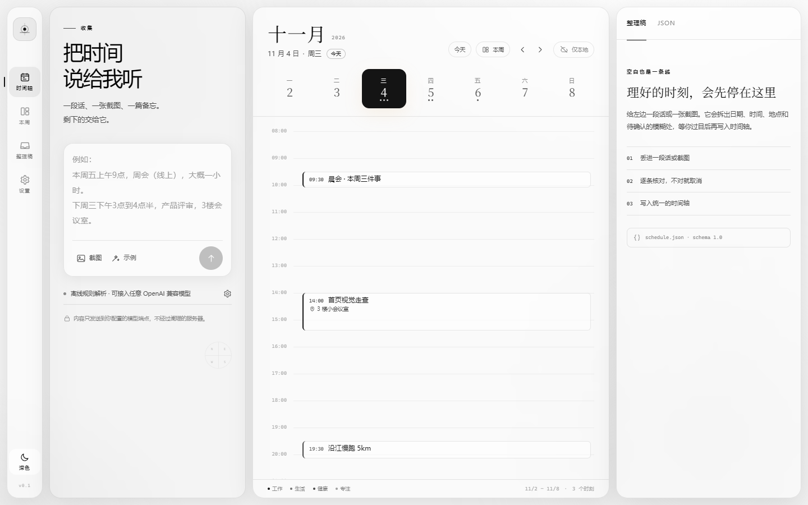
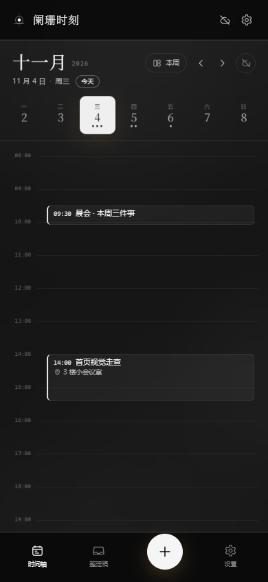
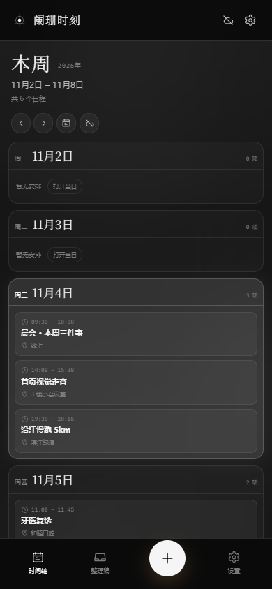
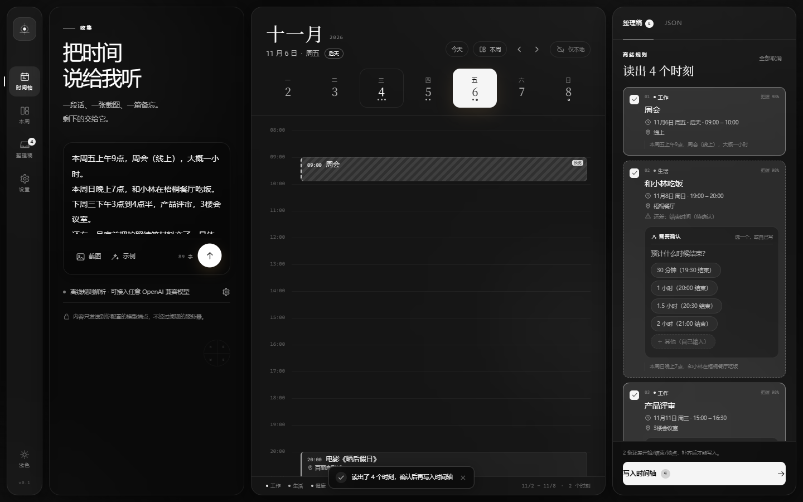
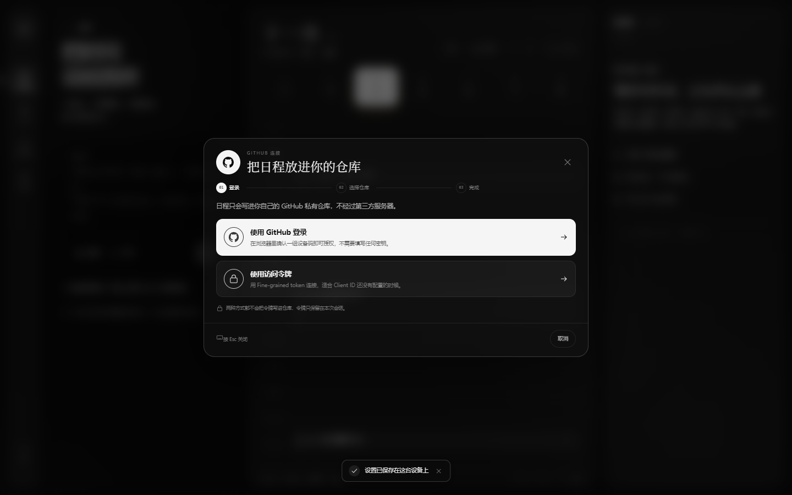

# 阑珊时刻

> 把散落的时间，收拢成一条看得见的光带。  
> 一段话、一张截图、一篇备忘 → AI 整理成统一日程 JSON → 落在时间轴上。



**v0.4.0 · Wails v3 平铺多窗口。** 采用墨辰（DarkCube）同款黑白液态玻璃视觉，日间/夜间双主题；桌面端改为 AE 式顶部菜单、自动铺满的平铺窗口与独立原生窗口；手机端改为课程表式周视图；模型接口支持提供商预设、获取并选择模型，API Key 保存在本机。截图使用临时示例数据；安装后默认不附带演示日程。

<p>
  
  
</p>

在线 Demo：GitHub Pages 首次部署正在队列中；完成前请本地 `npm run dev`，或直接下载 Windows / Android 安装包。  
最新安装包：[GitHub Releases](https://github.com/sinsine/lanshan-moments/releases)

技术判断、排期与风险见 [可行性分析](./docs/feasibility.md)；界面与交互取舍见 [前端设计讨论](./docs/frontend-design.md)；数据协议见 [数据模型](./docs/data-model.md)。

---

## 这一版新增

- **桌面顶部菜单**：取消左侧导航，改为 应用 / 编辑 / 窗口 三个菜单，风格跟随日间/夜间主题。
- **可拖拽窗口**：添加日程、周概览、时间轴、整理箱默认铺满工作区；窗口可自由拖动、缩放、重叠，点击置顶，关闭后可从「窗口」菜单重新打开。设置也是浮动窗口。
- **应用菜单**：关于阑珊时刻、关于作者、检查更新（读取 GitHub Releases）、退出。
- **编辑菜单**：撤销、重做、剪切、复制、粘贴、删除、全选，带快捷键提示。
- **窗口菜单**：时间轴、周概览、整理箱、添加日程、设置，全部为开关。
- **手机端周表**：类似课程表的七列周视图，顶部周切换，底部三个栏目：周表 / 时间轴 / 我的。
- **手机状态栏**：Android 启动后隐藏状态栏；移除点击按钮时的蓝色高亮和焦点框。
- **模型接口**：DeepSeek（默认）、OpenAI、通义千问、Moonshot、智谱、SiliconFlow、OpenRouter、Gemini、Ollama 预设；点「获取模型」从 `/models` 拉取并点选。
- **API Key 本地保存**：改存本机 `localStorage`，关闭应用后仍保留。
- **延续**：本周概览独立、AI 澄清选项、开始/结束/地点必填、图形化 GitHub Device Flow、Android 本地通知、多语言预留。

---

## Windows v0.4 构建

v0.4 的桌面壳在 `v4shell/`（Wails v3），构建前先把前端产物复制进去：

```powershell
npm run build
Remove-Item -Recurse -Force v4shell/dist -ErrorAction SilentlyContinue
Copy-Item dist v4shell/dist -Recurse
Push-Location v4shell
go build -o lanshan-v4.exe .
Pop-Location
```

生成 `v4shell/lanshan-v4.exe`。v0.3 的 Wails v2 构建仍保留在根目录 `wails.json`。

## 快速开始（网页版）

需要 Node.js 22+。

```bash
npm install
npm run dev
# http://localhost:5173
```

不配置任何 Key 的演示路径：

1. 点输入框下方的「示例」。
2. 点圆形「↑」。
3. 右侧出现 4 条草稿；其中“和小林吃饭”会追问结束时间，“周会”会追问是否参加。
4. 回答选项、取消“护照续签”后点「写入时间轴」。
5. 点顶部「本周」查看整周；点「JSON」查看统一格式。

---

## Windows 端

已构建的便携版在 [GitHub Releases](https://github.com/sinsine/lanshan-moments/releases) 提供（Wails v2 + WebView2，约 14 MB）。本地构建脚本：`scripts/build-windows.ps1`。

手动构建：

```powershell
npm run build
wails build -s -skipbindings -clean -webview2 embed
# 输出：build/bin/lanshan.exe
```

要求：Go 1.26+、Wails v2.17+、WebView2 Runtime。项目路径包含中文时，建议在 ASCII 路径（例如 `C:\dev\lanshan`）下构建；`main.go` 使用 `//go:embed all:dist`。

Windows 端使用 Go 原生代理访问 GitHub Device Flow，绕过 WebView 的 CORS 限制。

---

## Android 端

已构建的调试包在 [GitHub Releases](https://github.com/sinsine/lanshan-moments/releases) 提供。本地构建脚本：`scripts/build-android.ps1`。

手动重新构建：

```powershell
# 需要 JDK 21（Capacitor 8 要求）、Android SDK 36、platform-tools
$env:JAVA_HOME="C:\path\to\jdk21"
$env:ANDROID_HOME="$env:LOCALAPPDATA\Android\Sdk"
npm run build
npx cap sync android
cd android
.\gradlew.bat assembleDebug
# 输出：android\app\build\outputs\apk\debug\app-debug.apk
```

测试机：**一加 Ace 6T / ColorOS 16（Android 16）**。USB 调试 + USB 安装后：

```powershell
adb install -r release\lanshan-debug.apk
```

ColorOS 额外设置（不设置会出现“通知不响/后台被杀”）：

- 设置 → 通知与状态栏 → 应用通知管理 → 阑珊时刻：允许通知、横幅、锁屏。
- 设置 → 电池 → 更多设置 → 应用耗电管理 → 阑珊时刻：允许完全后台行为、允许自启动。
- 设置 → 应用 → 特殊应用权限 → 闹钟和提醒：允许。
- 最近任务里给阑珊时刻加锁。

提醒在应用设置 → 提醒中开启；系统限制下不能保证 100% 准点，未授权精确闹钟时会提示可能延迟。

---

## GitHub 连接（网页授权）

“用 GitHub 网页登录”使用 **OAuth Device Flow**：点击后打开 GitHub 授权页，输入设备码即可，不需要把 client secret 放进客户端。

首次需要创建一个 OAuth App（约 2 分钟）：

1. 打开 GitHub → Settings → Developer settings → OAuth Apps → **New OAuth App**。
2. Application name 填 `阑珊时刻`；Homepage URL 填 `https://github.com/sinsine/lanshan-moments`。
3. **Redirect URI** 填同一个地址；如果输入框不可编辑，先点 **Add redirect URI**。
4. 勾选 **Enable Device Flow**；**取消勾选** **Expire user access tokens**（当前版本尚未实现 refresh token）。
5. 点 **Register application**。进入应用页后确认 Device Flow 已开启，再复制 **Client ID**（不是 Client secret）。当前安装包已内置该 Client ID，普通用户不需要自己创建 OAuth App。
6. 粘贴到「设置 → 多设备同步 → OAuth App Client ID」，保存。
7. 点击「用 GitHub 网页登录」→ 复制设备码 → 在 GitHub 页面确认 → 选择/新建私有仓库。

详细图文步骤：[GitHub OAuth 手把手配置](./docs/github-oauth-setup.md)。

也可以把 Client ID 写进 `.env`：

```bash
VITE_GITHUB_CLIENT_ID=Iv1.xxxxxxxx
```

> 浏览器 PWA 受 CORS 限制，无法直接调用 GitHub 设备码接口；网页版请使用“访问令牌”。Windows/Android 原生壳通过 Go / CapacitorHttp 代理，可以完成网页授权。客户端永远不需要 client secret。

### 访问令牌兜底

1. 新建一个 **私有** 仓库（例如 `lanshan-schedule`）。
2. 创建 [fine-grained PAT](https://github.com/settings/personal-access-tokens/new)，只勾选该仓库的 **Contents: Read and write**。
3. 在 GitHub 连接弹窗选择「使用访问令牌」，粘贴并验证，选择仓库后连接。

同步是事件级合并，不是“远端覆盖本地”；删除使用墓碑，SHA 冲突会重拉、合并、重试。完整协议见 [data-model.md](./docs/data-model.md)。

---

## 界面

| 桌面 · 深色 | 桌面 · 浅色 |
|---|---|
|  |  |

| 移动端 · 时间轴 | 移动端 · 本周 |
|---|---|
|  |  |

| 整理稿与 AI 追问 | GitHub 图形化连接 |
|---|---|
|  |  |

---

## 技术栈

| 层 | 实现 |
|---|---|
| UI | React 19 + TypeScript + Vite 8 |
| 样式 | 原生 CSS + 墨辰黑白玻璃 design tokens |
| 本地存储 | localStorage（Demo）；生产迁移 IndexedDB / SQLite |
| AI | OpenAI Chat Completions 兼容接口，BYOK；`temperature=0.1`，JSON 输出 |
| 同步 | GitHub Contents API，单 `schedule.json`，事件级 LWW + 墓碑 |
| Windows | Wails v2 + Go + WebView2；原生 GitHub HTTP 代理 |
| Android | Capacitor 8 + JDK 21 + SDK 36；Local Notifications |
| 通知 | `@capacitor/local-notifications`，提前 10 分钟；精确闹钟授权入口 |
| 多语言 | 简体中文；`src/i18n.ts` + 模块级 COPY，预留语言包 |

```
.
├── android/              # Capacitor Android 工程
├── build/                # Wails 图标/清单
├── docs/                 # 可行性、设计、数据模型、截图
├── public/               # PWA manifest / 图标 / service worker
├── schema/               # 统一日程 JSON Schema
├── scripts/              # 构建脚本（后续补）
├── src/
│   ├── components/       # 采集/时间轴/本周/整理稿/GitHub/设置
│   ├── lib/              # ai / parser / clarify / sync / notifications
│   ├── i18n.ts
│   └── App.tsx
├── app.go / main.go      # Wails Go 壳
├── capacitor.config.ts
└── release/              # 本地构建产物（不提交，随 Release 上传）
```

---

## 版本与发布

- `v0.1.0`：可行性 Demo（Web）。
- `v0.2.0`：本周概览、墨辰视觉、AI 追问、必填校验、GitHub 图形化连接、Windows / Android 初版。
- `v0.2.1`：ColorOS 16 / Android 16 安全区修正，版本号同步。
- `v0.2.2`：内置公开 Client ID；已验证 GitHub 设备码接口。
- `v0.3.0`：顶部菜单、自由浮动窗口、手机周表、状态栏隐藏、模型预设/获取模型/Key 本地保存。
- `v0.3.1`：401 提示、同步高级项折叠、移除时间轴本周按钮、无演示日程、登录持久化、无边框窗口。
- `v0.4.0`：Wails v3、平铺实时回流、拖拽预览、独立原生窗口、跨窗口同步。

每个版本会提交到 GitHub，并在 Releases 上传 Windows 可执行文件和 Android APK。源码提交与构建产物分开，避免仓库体积膨胀。

---

## 已知限制

- 网页版 GitHub Device Flow 受 CORS 限制，只能走访问令牌；Windows/Android 原生端可用网页授权。
- Android 桌面小组件尚未实现；本地通知与精确闹钟授权已接入。
- 精确闹钟受 ColorOS/Android 后台策略影响，不能承诺 100% 准点。
- 重复事件、拖拽改期、时区选择器、E2EE 尚未进入 1.0。
- 图片解析需要支持视觉的模型；未配置时明确提示，不假装 OCR。

---

## 安全与隐私

- 公开仓库不包含真实日程、Token、API Key；示例数据全部虚构。
- API Key 与 GitHub Token 按用户要求保存在本机 `localStorage`，关闭/更新应用后仍保留。原生端后续会迁移到系统钥匙串。
- fine-grained PAT 只申请目标私有仓库的 Contents 读写；OAuth 只使用公开 Client ID。
- 同步可选；默认单机可用。日程敏感，是否把原文发给模型必须由用户选择。

---

## License

[MIT](./LICENSE)


