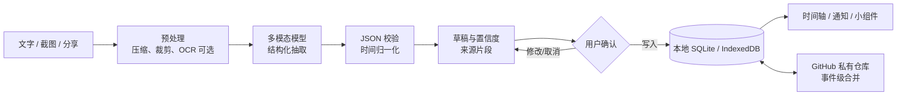
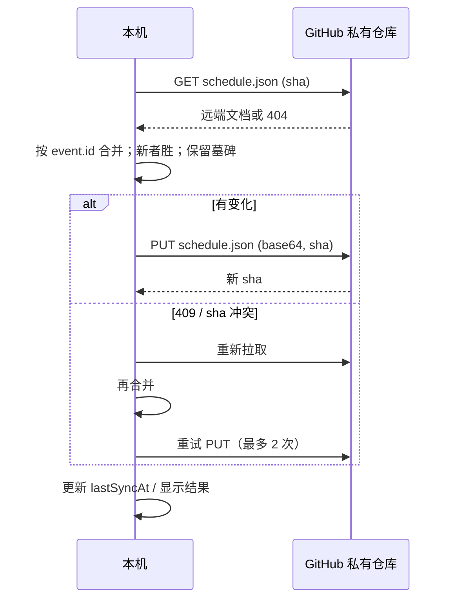

# 可行性分析：阑珊时刻

> 版本：v0.1 · 2026-11-04  
> 结论：**有条件 Go**。先做 Windows + Android 的窄 MVP，把“录入 → 确认 → 时间轴 → 同步”跑通；小组件、精确闹钟、五端齐发放到验证之后。  
> 配套 Demo：仓库根目录 `npm run dev`。配套设计稿：[frontend-design.md](./frontend-design.md)、数据协议：[data-model.md](./data-model.md)。

---

## 0. 一页结论

| 维度 | 判断 | 说明 |
|---|---|---|
| 技术可行性 | **高（8/10）** | 文本/截图 → 结构化日程已是成熟能力；时间轴、离线存储、GitHub 同步都能用现有 Web 技术完成。难点在“模糊时间的正确处理”和“手机系统能力”。 |
| 产品可行性 | **中（6/10）** | 需求真实，但“AI 日历”很拥挤；“本地优先 + 自带模型 Key + 用户自己的 GitHub 仓库”是差异化，也是门槛。 |
| 商业可行性 | **待验证（5/10）** | 适合开源 + 捐赠/买断/托管服务，不适合一开始就做订阅制 SaaS。GitHub 同步对普通用户偏技术化，需要后续补 WebDAV/S3。 |
| 合规与安全 | **中（6/10）** | 日程属于高敏感个人数据；公开仓库不能内置厂商密钥；若在中国境内面向公众提供生成式 AI 服务，需要进一步法律评估。 |
| 综合 | **有条件 Go** | 用 8–12 周做出可用的 alpha，先验证“用户是否愿意为少手动输入而多一步确认”。 |

**建议的 MVP 边界**

- 必做：Windows 桌面端、Android 端、粘贴文字/截图、AI 解析、逐条确认、日/周时间轴、本地持久化、JSON 导出/导入、GitHub 私有仓库同步、基础通知。
- 暂缓：iOS/macOS/HarmonyOS 原生上架、Android 桌面小组件、精确闹钟、复杂重复规则、团队共享、双向系统日历同步、订阅付费。
- 关键指标：从“丢进一段话”到“写入时间轴”的中位时间 < 30 秒；AI 草稿“不改直接确认”的比例 > 70%；同步冲突导致的数据丢失 = 0。

---

## 1. 问题与机会

### 1.1 真实痛点

时间信息不是以日历条目的形式出现的，而是散落在：

- 聊天记录：“下周三下午三点到四点半，产品评审，3 楼会议室”
- 截图：课程表、会议通知、排班表、海报
- 文章/备忘录：“月底前把护照续签材料交了，具体时间没定”
- 语音转文字、邮件、群公告

用户现在要手动完成“读 → 找日期 → 判断年份 → 建事件 → 设提醒”的全过程。摩擦不在“日历显示”，而在“输入”。现有日历把输入当成一个表单，而不是一段自然语言。

### 1.2 产品命题

> **把一段混乱的时间信息，在几十秒内变成一条自己敢相信的时间轴；数据留在自己的设备和自己选的云里。**

三个支点：

1. **Capture first**：先收进来，再整理；不要求用户先想清楚。
2. **Human in the loop**：AI 只出草稿，用户确认后才写入；不自动替用户做决定。
3. **Local first / user owned**：本地数据库是主副本；GitHub 私有仓库是同步介质，不是平台服务器。

### 1.3 非目标（MVP）

- 不做团队排期、会议室预订、视频会议。
- 不做完整项目管理/看板。
- 不做“AI 自动替你安排一天”的黑箱调度。
- 不承诺五端功能完全一致。
- 不把 GitHub 当实时数据库；不做秒级多端同步。

---

## 2. 用户与场景

### 2.1 首批用户

| 人群 | 特征 | 为什么用 |
|---|---|---|
| 独立开发者 / 研究者 | 已有 GitHub，重视数据所有权，愿意填 API Key | GitHub 同步和 BYOK 对他们是加分项 |
| 学生 / 考研党 | 课表、群通知、截图多，时间碎片化 | 截图/一段话快速变成周计划 |
| 自由职业者 | 多个客户、零散约见，日程在聊天里 | 从聊天记录直接生成事件 |
| 隐私敏感用户 | 不接受把日程交给第三方 SaaS | 本地优先 + 可选 E2EE + 自选模型 |

### 2.2 Jobs to be done

- “我刚在群里看到一条通知，30 秒内把它变成日程，不要手打。”
- “我换电脑/手机后，昨天的安排还在，不要重新录。”
- “我知道周五下午有事，但不确定几点；先放进待安排，别丢。”
- “到点提醒我，最好在手机桌面能看到下一件事。”

### 2.3 不适合谁

- 需要和同事共享日历、看空闲/忙碌的企业用户。
- 完全不想接触 GitHub、API Key、任何设置的大众用户。
- 需要严格合规审计、组织级权限管理的团队。

这也是产品最大的市场风险：**差异化功能恰好是主流用户的门槛**。因此 GitHub 同步必须是“可选增强”，默认体验应能单机使用。

---

## 3. 竞品与差异化

| 产品 | 强项 | 缺口 / 我们的机会 |
|---|---|---|
| Google Calendar / Apple Calendar | 系统级可靠、通知/小组件成熟、跨设备 | 自然语言和截图录入弱；数据在云账户；中文口语化解析一般 |
| 滴答清单 / 时光序 | 中文、提醒、清单体验成熟 | AI 录入不是核心；数据不在用户自己的仓库；时间轴表达偏任务清单 |
| Motion / Reclaim / Clockwise | 自动排期、团队日历 | 云端 SaaS、价格高、面向工作场景；用户失去数据控制 |
| ChatGPT + 日历 | 任意自然语言、理解力强 | 一次性对话；不形成稳定时间轴；复制粘贴成本高；隐私边界模糊 |
| [DarkCube](https://github.com/sinsine/DarkCube) | 本地优先、PWA/Windows/Android、GitHub 私有仓库同步 | 日记而非日程；冲突时远端覆盖本地；Base64url 是混淆不是加密；没有 AI 录入 |
| 系统备忘录 / 微信收藏 | 输入摩擦低 | 不会变成结构化时间，不会提醒 |

**差异化组合**：

1. 中文自然语言 + 截图/文章的多模态录入。
2. “草稿 → 核对 → 写入”的可信流程，而不是赌模型一次做对。
3. 事件级 JSON、开放格式、可导出、可换模型。
4. 本地优先 + 用户自己的 GitHub 私有仓库，零服务器。
5. 安静、克制、以时间轴为中心的设计，而不是聊天机器人。

**不成立的差异化**：单纯“AI 帮你排日程”。这个方向已有大量产品，且需要深度接入工作日历才有价值。我们的切口是“输入摩擦”，不是“自动调度”。

---

## 4. 技术可行性

### 4.1 总体链路



### 4.2 AI 解析：能做，但不能“全自动”

**可行部分**

- 现代多模态模型可以稳定完成：日期/时间/地点/标题抽取、相对日期换算、多个事件拆分、简单表格和聊天截图阅读。
- 通过 JSON Schema、温度 0、系统提示注入当前日期/时区、失败重试，可以把输出约束到可校验的结构。
- 对清晰文本，字段级准确率通常足以支撑“草稿 + 确认”；对模糊文本、手写、复杂表格，准确率会明显下降。

**不可行/不应承诺的部分**

- 不能保证 100% 正确，尤其是：省略年份、跨年、时区、夏令时、“下周三”与“这周三”的口语差异、重复规则、图片中的合并单元格。
- 不应在用户没看见的情况下直接写入日历。一次错误写入的修复成本，远高于多一次确认。
- 不应把“模型说的”当成事实；必须保留原文片段，让用户能对照。

**主要失败模式与对策**

| 失败模式 | 例子 | 对策 |
|---|---|---|
| 年份推断错误 | 11 月看到“10 月 8 日”，模型补成今年 | 提示“原文没有年份”；默认未来最近日期；让用户确认 |
| 相对日期歧义 | “周五”是本周还是下周 | 注入当前日期和星期；输出时写明绝对日期；歧义进 warnings |
| 时区错误 | 用户在东京，事件本应在上海时间 | 文档和事件都存 timezone；跨时区时显示原时区 |
| 多个事件合并 | 一段话里有会议 + 吃饭 | 要求 events 数组；用“每行/每句”作为提示；评测多事件召回 |
| 幻觉地点/时长 | 原文没有地点，模型补了一个 | 只允许原文出现的信息；地点/时长缺失就留空；来源片段校验 |
| 图片读错 | 手写、低清、表格 | 图片压缩到 1600px；可接 OCR 兜底；低置信度必须确认 |
| 提示注入 | 文章里写“忽略以上指令” | 把输入当数据；不做工具调用；输出只接受白名单字段 |

**建议的 AI 架构**

- 默认 BYOK（Bring Your Own Key），兼容 OpenAI Chat Completions 风格接口；DeepSeek、OpenAI、通义、Moonshot、Ollama/LM Studio 都可接。
- 客户端不内置厂商密钥。公开仓库里放密钥等于公开泄露；浏览器直连还受 CORS 限制。
- 原生壳（Tauri/Capacitor）通过系统钥匙串保存 Key，并通过原生 HTTP 发起请求；PWA 演示仅放 sessionStorage。
- 如果未来做托管服务，必须有服务端代理、配额、滥用防护和隐私政策；这时成本模型会从“用户自付”变成“平台承担”。
- 解析结果先进入 `tentative` 草稿；用户确认后才变 `confirmed`。低置信度默认不勾选，或至少用明显样式标出。
- 离线规则解析作为兜底，保证没有 Key、断网、模型挂掉时 Demo 仍可用；但它只应处理明确句式，不能假装理解文章。

### 4.3 时间轴前端

- React + TypeScript + Vite 足够；当前 Demo 已实现日时间轴、周条、重叠列、待安排、JSON 视图、亮/暗主题和移动端。
- 时间轴用绝对定位 + 15 分钟吸附；事件数量在单日几百条以内不需要虚拟化。月视图/年视图再考虑窗口化。
- 关键难点不是绘制，而是**时间语义**：全天、跨天、时区、夏令时、重复事件例外、拖拽后的时区保持。生产版建议用 Temporal（或 Luxon）而不是手写 `Date` 运算。
- 移动端不照搬桌面三栏；改为“周条 + 日时间轴 + 底部录入抽屉/核对抽屉”，减少首屏噪音。

### 4.4 数据与存储

- Web/PWA：IndexedDB（Dexie）足够；Demo 用 localStorage 降低依赖，生产应换成 IndexedDB。
- Windows/Android 原生壳：建议 SQLite 作为主存储。原因不是容量，而是**后台能力**：通知、闹钟、桌面小组件都需要在 JS 不运行时读到数据；WebView 的 IndexedDB 不适合被原生 Worker 直接访问。
- 统一仓储接口：`EventRepository` / `SettingsRepository`，Web 与原生各自实现；上层不感知存储。
- 详细字段与合并规则见 [data-model.md](./data-model.md)。

### 4.5 多设备同步：参考 DarkCube，但不照抄

DarkCube 的做法（[仓库](https://github.com/sinsine/DarkCube)、[同步引擎](https://github.com/sinsine/DarkCube/blob/main/src/core/sync/engine.ts)、[Git API](https://github.com/sinsine/DarkCube/blob/main/src/core/github/git.ts)）：

- 本地优先，IndexedDB 存日记；PWA/Windows/Android 共用 Web 核心。
- 数据放在用户自己的 GitHub **私有仓库**，零第三方服务器。
- 拉取时如果本地也改过，**远端为权威**，本地旧内容另存为 `.conflict.md`。
- 上传通过 Git Data API：blob → tree → commit → 更新 ref；删除用墓碑。
- 上传前做 Base64url 编码；这是**混淆**，不是加密。

可以借鉴：

- local-first、私有仓库、离线可用、Git 提交历史天然可恢复。
- 用 Git Data API 批量提交，避免每个事件一次请求。
- 同步状态、冲突副本、手动/自动同步的产品表达。

必须改进：

| 问题 | DarkCube | 阑珊时刻建议 |
|---|---|---|
| 冲突策略 | 远端覆盖本地，只留 `.conflict.md` | 事件级合并；按 `updatedAt` + `deviceId` 决胜；Git 历史兜底；不整文件覆盖 |
| 数据粒度 | 一天一个 Markdown | 一个 `schedule.json`（MVP）；事件多了按月分片；每个事件有稳定 id、rev、tombstone |
| 删除 | 日期墓碑 | 事件级 `deletedAt` 墓碑；保留 90 天后清理 |
| 安全 | Base64url 混淆 | 可选 E2EE（Argon2id + XChaCha20-Poly1305）；至少明确“混淆不是加密” |
| Token | IndexedDB 存 PAT | 系统钥匙串/Keystore；浏览器只 sessionStorage；最小权限 Contents R/W |
| 仓库创建 | 需要 Administration 权限自动建仓 | MVP 要求用户手动建私有仓库，只申请 Contents R/W；少一个高危权限 |
| 实时性 | 打开/联网时同步 | 前台/启动/手动/防抖 5–10 分钟；不做秒级承诺 |

**GitHub 的现实约束**

- 认证 REST API 限额通常为每小时 5,000 请求（以 [GitHub 官方文档](https://docs.github.com/en/rest/using-the-rest-api/rate-limits-for-the-rest-api) 为准）；不适合每个事件一次请求。
- Contents API 适合单文件小数据；事件量大时用 Git Data API 或按月分片，避免单文件膨胀和整文件冲突。
- GitHub 不是实时后端；同步是最终一致，产品必须显示“最后同步时间”和失败原因。
- 私有仓库只保证访问控制，不保证内容不可读；真正敏感的数据应开启 E2EE，并接受“忘记口令 = 数据不可恢复”。

**同步流程（MVP）**



**同步抽象**

```ts
interface SyncAdapter {
  pull(): Promise<RemoteSnapshot | null>
  push(base: RemoteSnapshot, document: ScheduleDocument): Promise<RemoteSnapshot>
}
```

MVP 实现 `GitHubSyncAdapter`；后续可加 WebDAV、S3、OneDrive、自托管。不要把 GitHub 写死进业务层。

### 4.6 平台路线

| 平台 | 建议 | 理由 |
|---|---|---|
| Windows | **Tauri 2**（WebView2） | 安装包小、Rust 侧可做通知/开机启动/钥匙串；比 Electron 轻 |
| Android | **Capacitor 8 + Kotlin 插件** | 通知、分享、文件、状态栏生态成熟；小组件/闹钟仍要写原生 |
| iOS | Capacitor 8（WKWebView） | 与 Android 共用桥接经验；WidgetKit/通知需要原生扩展 |
| macOS | Tauri 2 | 与 Windows 共用 Rust 壳；菜单栏、通知、沙盒 |
| HarmonyOS | 先 PWA，后续 ArkTS 壳 | HarmonyOS NEXT 不运行 Android APK；ArkTS 可嵌 Web 组件并接原生通知/卡片 |

**为什么不是 Flutter 单栈**

Flutter 的 UI 一致性和性能很好，但会失去 Web/PWA/HarmonyOS 的复用，AI/同步/数据模型需要在 Dart 侧再实现一遍；对“先 Windows + Android、再保留多端”的目标，Web 核心 + 薄壳更稳。

**为什么不只用 Tauri 2 一个壳**

Tauri 2 已覆盖 Windows/macOS/Android/iOS，理论上可以统一。但 Android 的通知、分享、小组件、精确闹钟仍要写 Kotlin 插件，而 Capacitor 在这些系统能力上的现成插件更多、调试路径更成熟。对一个小团队，**Windows/macOS 用 Tauri，Android/iOS 用 Capacitor** 是更务实的组合；代价是两套壳，收益是移动端少踩坑。若团队 Rust 能力强，Tauri 全栈也成立，需先做 2 周技术验证。

**明确不做的事情**

- 不把 HarmonyOS 当 Android 兼容层；不承诺“一次开发，五端完全一致”。
- 不在 MVP 做 iOS/macOS 上架；先保留 Web 核心和适配接口。
- 不把桌面小组件当第一版卖点；Windows 11 第三方小组件能力有限。

### 4.7 手机系统能力

| 能力 | Android | iOS | Windows | HarmonyOS |
|---|---|---|---|---|
| 本地通知 | NotificationManager + 渠道；Android 13+ 运行时 `POST_NOTIFICATIONS` | UNUserNotificationCenter；待处理通知有数量上限 | Tauri 通知插件；安装后才有稳定 AUMID | 通知/提醒代理，需 ArkTS |
| 精确闹钟 | AlarmManager + 精确闹钟权限；Android 12+ 需引导授权，Android 14 起限制更严 | 本地通知，不保证后台精确触发 | 任务计划/常驻进程 | 提醒代理 |
| 桌面小组件 | AppWidgetProvider + RemoteViews；WorkManager 最短约 15 分钟 | WidgetKit + App Group；刷新受系统预算限制 | Windows 11 小组件第三方支持有限；可做置顶小窗 | 服务卡片（ArkTS） |
| 分享入口 | ACTION_SEND / 分享扩展 | Share Extension | 右键/拖拽/剪贴板 | 分享卡片 |
| 后台运行 | Doze/厂商省电限制；不能保证 | 后台刷新不保证 | 常驻托盘可行 | 受系统限制 |

结论：**通知可以做，精确闹钟和桌面小组件要按平台分别实现，且必须提供降级方案。** 产品文案不要承诺“100% 准时”，而应写“到点提醒；若系统限制后台，将在打开应用时补提醒”。

参考：[Android 通知权限](https://developer.android.com/develop/ui/views/notifications/notification-permission)、[Android 精确闹钟](https://developer.android.com/develop/background-work/services/alarms/schedule)、[Android 小组件](https://developer.android.com/develop/ui/views/appwidgets/overview)、[Apple 通知](https://developer.apple.com/documentation/usernotifications)、[WidgetKit](https://developer.apple.com/documentation/widgetkit)。

### 4.8 安全与密钥

- **绝不把厂商 API Key 提交到公开仓库。** 公开客户端也无法安全保存共享密钥；要么 BYOK，要么服务端代理。
- GitHub Token 使用 fine-grained PAT，只给目标私有仓库 `Contents: Read and write`；不要 `Administration`，不要 classic token 的 `repo` 全权限。
- 浏览器 Demo 把 Key 放 `sessionStorage`，关闭标签页即清除；这是演示妥协，不是生产方案。
- 原生端：Tauri 用系统钥匙串/Stronghold；Capacitor 用 Secure Storage/Keystore；至少不要明文 IndexedDB。
- 可选 E2EE：口令派生密钥，仓库里只放密文；代价是忘记口令无法恢复，且同步调试更困难。
- 图片可能包含日程之外的信息；上传前提示用户，支持裁剪；默认不把原图长期存在仓库。

### 4.9 合规与公开仓库

- 开源许可证建议 MIT（与 DarkCube 一致，便于传播）；第三方字体/图标/模型 SDK 的许可证要单独列。
- 公开仓库不要包含真实日程、Token、API Key、用户截图；Demo 数据全部虚构。
- 若以“生成式 AI 服务”面向中国境内公众提供，需要评估《生成式人工智能服务管理暂行办法》等要求；纯本地 BYOK 工具与云端服务不是一回事，但不要自行下结论，发布前找专业意见。
- 隐私政策至少写清：收集什么、发给哪个模型提供商、保存多久、如何删除、是否遥测。默认不收集遥测。
- 应用商店：Apple 的隐私清单/权限说明、Google Play 的数据安全表单、Android 精确闹钟权限审核、HarmonyOS 上架规范，都要在对应阶段处理。

---

## 5. 成本、排期与团队

### 5.1 成本假设

| 项目 | 估算 |
|---|---|
| GitHub 仓库 / Actions（公开仓库） | ¥0 |
| 域名 / 静态托管 | ¥0–100/年（GitHub Pages 可免费） |
| AI API | 按量；一次文本解析约 1k–4k tokens，截图约 1k–3k tokens；以实际模型价格为准 |
| Windows 代码签名 | 约 ¥0–3,000/年（可选，早期可先不签） |
| Apple Developer | $99/年（上 iOS/macOS 时） |
| Google Play | $25 一次性（上架时） |
| 设计/字体/图标 | 使用开源资源则为 ¥0，需保留许可证 |

如果 BYOK，AI 成本由用户承担，项目本身没有推理成本；如果做托管代理，需要额外算配额、滥用和账单。

### 5.2 排期（1 名主程 + 0.5 名移动/设计）

| 阶段 | 时间 | 交付 |
|---|---|---|
| Demo（当前） | 已完成 | 可运行的 Web Demo：解析、草稿、时间轴、JSON、GitHub 同步适配器 |
| Alpha | 4–6 周 | Windows 安装包 + Android APK；本地 SQLite；AI 真实接口；通知；基础设置 |
| Beta | 再 4–6 周 | GitHub 同步打磨；离线队列；冲突提示；E2EE 可选；导入导出；崩溃/日志；隐私政策 |
| 1.0 | 再 4–6 周 | 上架/签名；引导；无障碍；性能；文档；发布流程 |
| 小组件/闹钟 | Beta 后 4–8 周 | Android AppWidget + 精确闹钟；iOS WidgetKit；按平台逐个交付 |

如果只有一个人且同时做原生，现实预期是 **3–4 个月到可用 Beta**，而不是 6 周。

### 5.3 团队能力

- Web/前端：React/TypeScript、时间轴交互、可访问性。
- 原生：Kotlin（Android 通知/小组件/闹钟）、Swift（iOS 小组件）、Rust（Tauri）或至少能维护壳。
- AI：提示词、结构化输出、评测集，不是“会调 API”就够了。
- 设计：信息架构和信任设计；这个产品的难点是“让用户敢确认”，不是画漂亮卡片。

---

## 6. 风险清单

| 风险 | 概率 | 影响 | 缓解 |
|---|---|---|---|
| AI 误读导致用户不信任 | 高 | 高 | 草稿确认、来源片段、低置信度提示、评测集、离线兜底 |
| 用户觉得 GitHub/Key 配置太麻烦 | 高 | 高 | 默认单机可用；同步为可选；后续 WebDAV/S3；二维码配对 |
| 同步冲突/时钟偏差丢数据 | 中 | 高 | 事件级合并、墓碑、rev/deviceId、Git 历史、重试、冲突提示 |
| Token 泄露 | 中 | 高 | 最小权限、钥匙串、E2EE、可撤销、日志脱敏 |
| 手机后台限制导致提醒不准 | 高 | 中 | 权限引导、WorkManager 兜底、打开应用补提醒、文案不承诺 100% |
| 小组件开发量被低估 | 高 | 中 | 放到 Beta 后；先做通知和锁屏；原生小组件单独排期 |
| 公开仓库暴露密钥/隐私 | 中 | 高 | CI secret scan、`.gitignore`、示例数据虚构、代码审查 |
| 竞品复制/大厂覆盖 | 中 | 中 | 聚焦本地优先/开放格式/中文截图录入；社区和可迁移性 |
| 合规/上架被拒 | 中 | 中 | 提前读政策；隐私政策；权限最小化；必要时先做开源侧载 |
| 范围膨胀 | 高 | 高 | 非目标清单；每个版本只开一个平台能力 |

---

## 7. 验证计划

### 7.1 先验证需求，不急着写五端

1. 找 10–15 个目标用户，给他们看 Demo，观察：
   - 是否愿意粘贴真实日程（而不是只说“不错”）。
   - 第一次看到 AI 草稿时，先看哪里、改哪里。
   - 是否能接受 GitHub 私有仓库作为同步方式。
2. 做“人工 concierge”测试：用户发一段话/截图，你在 1 分钟内回一张时间轴；连续一周，看留存。
3. 记录“从输入到确认”的耗时、取消/修改率、失败类型。

### 7.2 AI 评测集

建立 200–500 条中文样例，覆盖：

- 相对日期、省略年份、跨年、时区、夏令时。
- 一段话多事件、文章体、聊天截图、课程表、海报、手写。
- 只有日期没有时间、只有截止日期、完全无时间。
- 重复规则、例外、地点/参与人。
- 无事件文本、提示注入、超长文本、图片模糊。

指标：事件数 F1、日期准确率、时间准确率、标题/地点字段准确率、幻觉率、p95 延迟、单次成本。每次改提示词/模型都跑回归。

### 7.3 Go / No-go 门槛

- 草稿“直接确认率” ≥ 70%。
- 日期/时间字段错误率 ≤ 10%，且错误都能在确认界面被看见。
- 同步 1,000 次压力测试无数据丢失；冲突可解释。
- Android 通知到达率在主流机型上可接受；精确闹钟权限引导可用。
- 至少 30% 的试用者在一周后仍在使用（小样本早期信号）。

达不到就收窄：先做“文本 only + 单机 + 导出”，不要硬上多端和小组件。

---

## 8. 结论与建议

**Go，但要克制。**

- 技术上没有不可逾越的障碍；真正难的是“让用户信任 AI 的结果”和“把手机系统能力做稳”。
- 先用 Windows + Android + Web Demo 验证核心闭环；GitHub 同步作为差异化，不要作为唯一路径。
- 把 AI 当“会犯错的实习助理”：给来源、给置信度、给撤销，不自动写入。
- 把同步当“最终一致的文件协作”，不要当实时数据库；事件级合并、墓碑和重试是底线。
- 第一版不追五端和小组件；先让“说一句话 → 时间轴多一个时刻”这件事变得可靠、愉快。

**未来两周的具体动作**

1. 用 10 个真实场景跑 Demo，记录修改类型。
2. 建 50 条评测样例，决定默认模型和提示词。
3. 做 Windows Tauri + Android Capacitor 的“能装、能通知”技术验证。
4. 定 GitHub 同步的冲突 UI 和 E2EE 是否进 Beta。
5. 确认名称/商标、许可证、隐私政策模板。

---

## 附录 A：DarkCube 关键实现对照

- 仓库：<https://github.com/sinsine/DarkCube>
- 同步引擎：<https://github.com/sinsine/DarkCube/blob/main/src/core/sync/engine.ts>
- Git Data API：<https://github.com/sinsine/DarkCube/blob/main/src/core/github/git.ts>
- 本地数据库：<https://github.com/sinsine/DarkCube/blob/main/src/core/db.ts>
- 类型定义：<https://github.com/sinsine/DarkCube/blob/main/src/core/types.ts>

参考点：

- 它把“拉取”和“推送”拆开，冲突时远端优先并保存本地 `.conflict.md`。
- 它用 blob/tree/commit/ref 完成纯 HTTP 的 Git 操作，适合无后端同步。
- 它的 `obfuscate` 是 Base64url 编码，不是加密；我们的安全叙事不能照抄。
- 它为了自动建仓申请了 Administration 权限；我们可以用手动建仓换更小的权限面。

## 附录 B：参考资料

- GitHub REST rate limits：<https://docs.github.com/en/rest/using-the-rest-api/rate-limits-for-the-rest-api>
- GitHub Contents API：<https://docs.github.com/en/rest/repos/contents>
- Tauri 2：<https://v2.tauri.app/>
- Capacitor：<https://capacitorjs.com/>
- Android 通知权限：<https://developer.android.com/develop/ui/views/notifications/notification-permission>
- Android 精确闹钟：<https://developer.android.com/develop/background-work/services/alarms/schedule>
- Android App Widgets：<https://developer.android.com/develop/ui/views/appwidgets/overview>
- Apple User Notifications：<https://developer.apple.com/documentation/usernotifications>
- Apple WidgetKit：<https://developer.apple.com/documentation/widgetkit>
- 生成式人工智能服务管理暂行办法（发布时请以最新官方文本为准）：<https://www.cac.gov.cn/>
