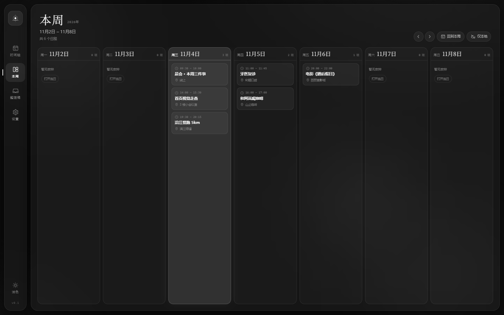

# 前端设计讨论稿：阑珊时刻

> 版本：v0.1 · 2026-11-04  
> 本文讨论“为什么这样设计”，不是单纯罗列页面。可运行 Demo 在仓库根目录；可行性判断见 [feasibility.md](./feasibility.md)，数据字段见 [data-model.md](./data-model.md)。



---

## 1. 设计命题

**把时间从“表单”里解放出来，变成一条可以看见、可以相信、可以修改的光带。**

“阑珊”取“灯火阑珊处”的意象：不是高亮、催促、满屏红色的效率工具，而是傍晚室内的一盏灯。界面要安静，信息要有层次，重要的事自己会发光。

### 1.1 一句话定位

> 对需要频繁处理碎片时间信息的人：把一段话或一张截图，整理成一条自己敢相信的跨设备时间轴。

### 1.2 不是什么

- 不是聊天机器人：没有大段对话气泡和“AI 正在思考”的表演。
- 不是待办清单：时间轴是空间，不是无限下拉的列表。
- 不是效率仪表盘：没有连续打卡、红色逾期、排行榜。
- 不是“AI 替你安排一切”：AI 是编辑，用户是主编。

---

## 2. 用户与关键场景

| 场景 | 用户动作 | 设计目标 |
|---|---|---|
| 群里看到会议通知 | 复制一段话，粘贴，确认 | 30 秒内完成，不找表单 |
| 收到一张课程表/排班截图 | 拖入图片，等草稿，逐条勾选 | 能看见“它读到了什么” |
| 文章里提到截止日期 | 粘贴文章段落，得到待安排项 | 不丢没有具体时间的事 |
| 换电脑/手机 | 打开应用，自动同步 | 知道“现在是不是最新的” |
| 到点前 | 手机通知/桌面小组件 | 不用打开应用也能看到下一件事 |
| 发现 AI 读错 | 在草稿里改/取消；或删除事件后撤销 | 错误可逆，不惩罚用户 |

---

## 3. 设计原则

### 3.1 先收进来，再整理

输入框不是“新建事件表单”，而是一个可以丢任何东西的入口。不要一上来要求标题、开始时间、结束时间、提醒、分类。先把原始信息接住。

### 3.2 AI 是编辑，不是权威

- 默认出草稿，不自动写入。
- 每条草稿都能看到原文片段。
- 不确定的地方用“待确认”标记，而不是假装确定。
- 低置信度默认不勾选，或至少用明显样式区分。
- 任何写入都可以撤销。

### 3.3 时间轴是空间，不是列表

列表适合“做完划掉”；时间轴适合“看见一天的长度和空隙”。事件块的位置、长度、重叠关系本身就是信息。

### 3.4 安静，但要有焦点

深色底、暖琥珀强调、少量类别色。没有大面积渐变、没有玻璃拟态堆叠、没有每张卡片都发光。一个屏幕只有一个主行动。

### 3.5 离线是正常状态，不是错误

“仅本地”不是警告，是默认。同步状态要可见，但不要用红色感叹号吓用户。失败时告诉他们“数据还在本机”。

---

## 4. 信息架构

### 4.1 桌面端：四栏，对应四个动作

```
┌────┬──────────────┬──────────────────────────────┬──────────────────┐
│    │              │  十一月  2026        [今天]  │ 整理稿 3   JSON   │
│ 导 │  把时间      │  11月6日 · 周五 · 后天       │                  │
│ 航 │  说给我听    │  ┌──┬──┬──┬──┬──┬──┬──┐    │ 读出 4 个时刻     │
│    │              │  │一│二│三│四│五│六│日│    │ ┌──────────────┐ │
│ 时 │ ┌──────────┐ │  └──┴──┴──┴──┴──┴──┴──┘    │ │ 周会       ✓ │ │
│ 间 │ │ 输入文字  │ │                              │ │ 09:00–10:00  │ │
│ 轴 │ │ 或截图    │ │  08:00 ─────────────────    │ └──────────────┘ │
│    │ └──────────┘ │  09:00 ─────────────────    │ ┌──────────────┐ │
│ 整 │  [截图][示例]│  10:00 ─────────────────    │ │ 产品评审   ✓ │ │
│ 理 │        [↑]   │        ▓▓ 09:00 周会        │ └──────────────┘ │
│ 稿 │              │  11:00 ─────────────────    │                  │
│    │ 离线规则解析 │  12:00 ─────────────────    │ [写入时间轴 3]   │
│ 设 │              │                              │                  │
│ 置 │              │  ……                          │                  │
└────┴──────────────┴──────────────────────────────┴──────────────────┘
   说                  看                              核
```

- 左栏 72px：品牌、时间轴、整理稿、设置、主题。
- 采集栏 360px：输入、图片、解析、引擎状态、隐私说明。
- 时间轴：周条 + 日时间轴，是视觉主体。
- 整理稿 336px：AI 草稿/JSON，是“确认”发生的地方。

**为什么是三栏而不是两栏**：输入、查看、核对是三个不同的注意力状态。把它们放在同一屏，用户不用在页面之间跳；同时用列宽明确主次。窄屏时右栏变成抽屉，而不是挤压时间轴。

### 4.2 移动端：周条 + 日轴 + 两个抽屉

```
┌────────────────────────────┐
│ ◉ 阑珊时刻        ☁︎  ⚙︎   │
│ 十一月 2026                │
│ 11月4日 · 周三 · 今天      │
│ 一 二 三 四 五 六 日        │
│ 2  3 [4] 5  6  7  8        │
├────────────────────────────┤
│ 08:00 ───────────────      │
│ 09:00 ───────────────      │
│       ▓ 09:30 晨会         │
│ 10:00 ───────────────      │
│ ……                         │
├────────────────────────────┤
│ 时间轴   整理稿   ＋   设置 │
└────────────────────────────┘
```

- 采集和核对不占常驻空间；点“＋”从底部升起采集抽屉，解析后自动切到核对抽屉。
- 周条保留 7 天和事件点，左右箭头切周；移动端不做月网格，避免小屏信息过载。
- 底部导航四项足够；中央“＋”是主行动，尺寸和颜色都高于其他项。

---

## 5. 核心流程

### 5.1 文字录入

1. 用户粘贴一段话（可含多行/多事件）。
2. 点“↑”或 `Ctrl/Cmd + Enter`。
3. 左栏显示阶段文案；右栏出现骨架屏。阶段文案是解释性的，不是假装进度条。
4. 右栏出现草稿：标题、日期、时间、地点、置信度、警告、原文片段。
5. 低置信度/有警告的条目不默认勾选（Demo 为了展示全流程默认勾选；生产建议按阈值调整）。
6. 用户勾选/取消，点“写入时间轴”。
7. 时间轴出现事件，Toast 提供“撤销”。

### 5.2 图片录入

- 拖拽、粘贴、选择文件都可以。
- 客户端先缩放到最长边 1600px、JPEG 0.84，减少传输和 token。
- 图片预览显示尺寸；解析时把图片作为 `image_url` 传给视觉模型。
- 没有配置视觉模型时，明确告知“需要支持视觉的模型”，不假装 OCR 成功。
- 图片可能含隐私信息：上传前提示“只发送到你配置的端点”，不默认长期保存原图。

### 5.3 从 AI 草稿到时间轴

- 草稿不是最终事件：`status: tentative`，时间轴上以虚线/斜纹预览。
- “写入”是显式动作；不做“AI 自动加入”。
- 写入后保留 `source.excerpt`，事件详情里能追溯“这句话是从哪来的”。
- 删除是软删除（墓碑），保留撤销；同步时墓碑也会传播。

### 5.4 同步

- 顶部显示“仅本地 / 已连接 / 已同步 22:31 / 同步中”。
- 点击未连接状态 → 设置里的同步页；点击已连接 → 立即同步。
- 同步失败：Toast 说明原因；数据仍在本地；不清空。
- 冲突：不用“覆盖/被覆盖”这种技术词；展示“云端有一版更新的记录，已按时间合并”，并给“查看 Git 历史”入口。
- 首次配置：私有仓库 + fine-grained PAT；提供图文步骤，不要求用户理解 Git。

---

## 6. 页面规格

### 6.1 采集栏

**目标**：让用户敢把乱七八糟的东西丢进来。

- 标题：“把时间 / 说给我听”，两行，34–40px，字重 400，负字距。
- 副标题：一段话、一张截图、一篇备忘。剩下的交给它。
- 输入框：无边框，行高 1.95，占位符给两个具体例子，不用“请输入内容”。
- 工具行：截图、示例、字数、发送圆钮。
- 引擎行：未配置时写“离线规则解析 · 可接入任意 OpenAI 兼容模型”；已配置时写“由 deepseek-chat 整理”。点击进设置。
- 隐私脚注：内容只发送到你配置的模型端点，不经过阑珊的服务器。
- 装饰：右下角一个极淡的方位刻度（N/E/W/S），呼应“时间/方位”，不抢注意力。

**文案语气**：短句、具体、不用“智能”“一键”“颠覆”。例如“读出了 4 个时刻，请过目”，而不是“AI 已完成智能解析”。

### 6.2 时间轴

- 顶部：月份（衬线大字）+ 年份（等宽小字）+ 选中日期/星期/相对日。
- 周条：周一到周日，日期数字用衬线；事件用 3px 琥珀点；草稿用空心点；选中日填充琥珀。
- 时间范围：默认 08:00–23:00；可滚动。跨过 00:00 的事件后续版本再处理。
- 小时线：极淡 1px；左侧 8.5px 等宽时间标签。
- 事件块：
  - 左侧 2px 类别色；
  - 背景从类别色 23% 过渡到 11%，形成“左边有一点光”的感觉；
  - 时间 8.5px 等宽，标题 12px；
  - 有空间时显示地点；
  - 草稿虚线 + 斜纹 + “预览”角标。
- 重叠：按簇分列，列宽均分；不做堆叠遮挡。
- 当前时间：琥珀细线 + 圆点 + “现在 22:31”；只在当天显示。
- 待安排：顶部虚线小条，显示数量；点击进入整理稿/待安排列表。
- 空状态：不画插画；一句“这一天还没有被安排”，一个“记一件事”。
- 底部图例：工作/生活/健康/专注；右侧显示本周范围和时刻数。

### 6.3 整理稿

- 顶部 Tab：整理稿 / JSON；整理稿带数量徽标。
- 空状态：三步说明（丢进来 → 核对 → 写入）+ `schedule.json · schema 1.0`。
- 解析中：轨道动画 + 三行骨架 + 当前阶段文案。
- 草稿卡片：
  - 勾选框（不是开关，避免“开启 AI”误解）；
  - 序号、类别标签、置信度；
  - 标题、日期/时间、地点；
  - 第一条警告（完整警告进详情）；
  - 原文引用，最多两行。
- 底部：说明“还没有写入” + 主按钮“写入时间轴 [n]”。
- JSON：只读、可复制/下载；语法高亮使用克制的琥珀/鼠尾草/蓝/玫瑰，不做彩虹。

### 6.4 事件详情

- 顶部类别色条；标题衬线大字。
- 时间、地点、备注、来源引用。
- 元信息：把握、状态、rev。
- 警告逐条显示。
- 底部“移出时间轴”（软删除，可撤销）。
- 事件 id 只显示前 16 位，等宽小字，方便调试但不干扰。

### 6.5 设置

三个 Tab：

1. **模型接口**：地址、模型、Key。说明浏览器 CORS/Key 风险；给出“仅本次会话”的明确提示。
2. **多设备同步**：GitHub 用户名、私有仓库、分支、fine-grained Token；说明只需要 Contents R/W；链接到 GitHub Token 创建页；显示同步结果。
3. **数据**：导出 JSON、导入 JSON、清空本机；说明“只删除本地，云端仍在”。

设置不是“控制面板”，而是一页解释：每个字段下面用小字说明“为什么需要它/风险是什么”。

### 6.6 移动端细节

- 顶部：品牌、同步、设置；不放大标题，给内容让位。
- 周条：高度 55–59px；日期数字 16–17px；周一为一周开始。
- 底部导航：72px + 安全区；中央按钮 52px。
- 采集抽屉：最大 92dvh，顶部拖拽条；输入框 106px；解析后直接切到核对抽屉。
- 核对抽屉：88dvh，内部滚动；底部按钮固定，避开安全区。
- 所有可点区域 ≥ 44×44（时间轴内的高密度事件块是例外，提供详情页作为补偿）。

---

## 7. 视觉系统

### 7.1 概念

**暮色纸本 / 灯的刻度**：深墨绿黑底，暖纸白字，琥珀作为唯一高饱和强调；类别色低饱和，像书脊上的标记。

### 7.2 色板

| Token | 深色 | 浅色 | 用途 |
|---|---|---|---|
| `--bg` | `#0b0e0d` | `#f3eee4` | 页面底 |
| `--panel` | `#0f1311` | `#faf6ee` | 栏/弹窗 |
| `--text` | `#e9e2d5` | `#2c2c25` | 正文 |
| `--muted` | `#99958a` | `#746e61` | 次要 |
| `--faint` | `#65665f` | `#9d9484` | 辅助 |
| `--amber` | `#e1a75c` | `#a96522` | 主强调/选中 |
| `--blue` | `#8da6c5` | `#536f95` | 工作 |
| `--rose` | `#d09489` | `#a55f57` | 生活 |
| `--sage` | `#8baa98` | `#4d725d` | 健康 |
| `--lilac` | `#b3a1c8` | `#735b8b` | 专注 |
| `--line` | 纸白 8.5% | 墨 11% | 分隔 |

规则：

- 琥珀只给“当前/主行动/现在”，一屏不超过 3 处大面积使用。
- 类别色只做小面积（左边框、点、标签），不整块铺满。
- 颜色不是唯一信息：类别同时有文字标签；草稿同时有虚线和“预览”；状态同时有文字。
- 浅色主题不是简单反色：降低饱和度、保留纸感；选中日仍用深琥珀底 + 米白字。

### 7.3 字体

- 中文 UI：MiSans / HarmonyOS Sans / PingFang SC / 微软雅黑，按系统回退。
- 标题/日期数字：Iowan Old Style / Palatino / Georgia / 宋体回退，制造“纸本”对比。
- 等宽：SF Mono / Cascadia / Consolas，用于时间、JSON、id、版本。
- 字号：正文 13–14px；辅助 9–11px；时间轴标题 12px；月份 34px；移动端月份 26–28px。
- 行高：正文 1.8–1.95；标题 1.24–1.35。
- 不要用全大写英文做主要标签；eyebrow 只用于 9px 的小节标识。

### 7.4 间距与形状

- 4px 基准；常用 8/12/16/24/32。
- 圆角：输入卡 17px；卡片 11px；按钮 8–9px；圆形按钮 50%。
- 边框优先于阴影；阴影只用于浮层和“抬起来”的输入卡。
- 不用厚重玻璃拟态；只在浮层/移动端头部用轻微 `backdrop-filter`。

### 7.5 图标

- 24 网格，1.55px 描边，圆角端点；线性、克制。
- 图标只做辅助；关键动作有文字（“写入时间轴”而不是只有一个箭头）。
- 品牌标记：圆环 + 竖线 + 一个实心点，像一盏灯/一个时刻，不做灯笼具象。

### 7.6 动效

- 入场：`translateY(12px)` + 淡入，640ms，`cubic-bezier(.22,.8,.2,1)`。
- 悬浮：160–180ms；按压 0.96–0.99。
- 抽屉：280ms 从底部；弹窗：240ms 轻微缩放。
- 解析：轨道/呼吸，不用无限旋转的“AI 光环”。
- 遵循 `prefers-reduced-motion`；所有动效都有静态替代。

---

## 8. 交互细节

| 交互 | 设计 |
|---|---|
| `Ctrl/Cmd + Enter` | 从输入框直接解析 |
| `N` | 聚焦采集框（移动端打开采集抽屉） |
| `Esc` | 关闭弹窗/抽屉 |
| 点击事件 | 打开详情；不做单击直接拖动 |
| 拖动事件 | Beta 再做；15 分钟吸附；松手后 Toast 撤销 |
| 点击空白时间 | 预填该日期/时间到采集框（后续） |
| 勾选草稿 | 整卡可点，不只点小方框 |
| 全选/取消 | 文字按钮，不用“全选”复选框 |
| 删除 | 软删除 + 撤销；同步墓碑 |
| 同步 | 顶部状态可点；失败不清空本地 |
| 冲突 | 事件级合并；显示“已合并”而不是“覆盖” |
| 加载 | 骨架 + 阶段文案；超过 15 秒给“取消/改用离线规则” |

### 8.1 置信度怎么表达

不要只写“98%”。百分比是给调试和高级用户的；普通用户需要的是：

- 高：无警告，正常样式。
- 中：黄色小警告“原文没有年份，已按最近的日期补全”。
- 低：虚线边框 + “建议确认” + 默认不勾选。

Demo 里保留百分比，是为了让评审看到模型不确定性；正式版可以把它收进详情。

### 8.2 空状态与错误

- 空时间轴：一句诗性但不矫情的文案 + 一个动作。
- 解析失败：“没有读到明确的时间。可以补一个日期，或换一段文字。”不显示模型原始报错，除非展开“技术详情”。
- 网络失败：“数据还在本机。检查网络后再同步。”不把用户困在错误页。
- 权限拒绝：“没有通知权限，提醒不会出现。去系统设置开启。”给路径，不反复弹窗。

---

## 9. 移动系统能力的设计

### 9.1 通知

- 通知标题：事件标题；正文：时间 + 地点；动作：完成 / 稍后 10 分钟 / 打开。
- 默认提前 10 分钟；可在事件详情改。
- 锁屏隐私：设置里可隐藏地点/标题，只显示“你有一个日程”。
- 不要为每个事件发“AI 已解析”通知；只发真正的日程提醒。

### 9.2 桌面小组件（Android / iOS）

- 2×2：下一件事 + 倒计时 + 今天剩余数量。
- 4×2：今天三条 + 当前时间线。
- 4×4：今日时间轴缩略 + 待安排数量。
- 配色跟随系统深/浅色；不使用大图。
- 点击组件：2×2 打开事件详情；4×2 打开今天；4×4 打开时间轴。
- 小组件不显示 AI 置信度/技术信息；只显示用户需要的事实。

### 9.3 闹钟/提醒

- “闹钟”与“通知”在语义上分开：闹钟是强提醒（响铃/全屏），通知是轻提醒。
- Android 精确闹钟需要单独权限和引导；不能静默失败。
- 如果系统限制后台，打开应用时补一条“错过的提醒”，不要假装准时。
- iOS 待处理通知有上限；只调度最近 N 条，其余在打开时补。

### 9.4 分享入口

- 从聊天/浏览器分享一段文字或图片 → 直接进入采集抽屉，预填内容。
- 分享扩展不自动解析，先让用户确认；避免“分享即写入”。

### 9.5 Windows

- 托盘常驻可选；关闭主窗口默认最小化到托盘。
- 通知用系统 Toast；首次安装后创建快捷方式，保证 AUMID。
- “桌面小组件”先做置顶小窗（Always on top），不追 Windows 11 Widget Board。

---

## 10. 可访问性

- 正文对比度 ≥ 4.5:1；大字号 ≥ 3:1；浅色主题单独测。
- 所有图标按钮有 `aria-label`；装饰性 SVG `aria-hidden`。
- 键盘可达：Tab 顺序按“导航 → 采集 → 周条 → 时间轴 → 整理稿”；弹窗焦点圈定（生产补焦点陷阱）。
- 时间轴事件是按钮，不是 div；有 `aria-label` 含时间/标题/地点。
- 颜色不是唯一编码；类别有文字；草稿有“预览”；警告有文字。
- 移动端点击目标 ≥ 44px；高密度事件块提供详情页。
- 动效可关闭；不强依赖 hover。
- 屏幕阅读器：周条读“11 月 6 日 周五，2 个日程”；时间轴读“09:00 到 10:00，周会，线上”。

---

## 11. 文案原则

- 说人话，不说“智能聚合”“多模态解析”“赋能”。
- 动词优先：“写入时间轴”“移出时间轴”“再同步一次”。
- 承认不确定：“没有写具体时间，按全天处理”“原文没有年份，已补全”。
- 不制造焦虑：不用“逾期”“失败”“你已落后”。
- 少量诗意，只出现在空状态和标题；功能文案保持具体。

示例：

| 场景 | 不要 | 要 |
|---|---|---|
| 解析中 | AI 正在施展魔法 | 正在辨认日期与时间… |
| 空整理稿 | 暂无数据 | 理好的时刻，会先停在这里 |
| 同步失败 | 同步错误 422 | 云端文件有变化，合并时出了点问题；本地数据还在 |
| 删除 | 删除成功 | “产品评审”已移出时间轴 · 撤销 |
| 无时间 | 解析失败 | 没有写具体时间，先放入待安排 |

---

## 12. 取舍与开放问题

### 12.1 已做的取舍

| 选择 | 放弃 | 理由 |
|---|---|---|
| 三栏桌面 | 单页聊天式 | 录入/查看/核对是三个注意力状态；同屏减少跳转 |
| 日时间轴为主 | 默认月网格 | 月网格在中文小屏上信息密度低；日轴更能表达“长度和空隙” |
| 深色优先 | 浅色优先 | “阑珊”是傍晚/夜间的意象；浅色作为日间替代 |
| 草稿确认 | 自动写入 | 一次错误写入的代价高于一次确认 |
| GitHub 私有仓库 | 自建同步服务器 | 零服务器、可审计、符合目标用户；但门槛高，后续补 WebDAV |
| 事件级 JSON | iCalendar 作为主格式 | 易合并、易调试；ICS 作为导出/互操作，不做主存储 |

### 12.2 需要和产品/用户确认的问题

1. **同步门槛**：首批用户能接受 GitHub + PAT 吗？如果不能，是否先做“导出/导入文件”作为过渡？
2. **默认视图**：打开应用先看到“今天”还是“本周”？Demo 选今天；周视图可能更适合桌面。
3. **自动写入**：是否在用户连续 10 次确认后，对高置信度单事件提供“自动加入”开关？建议默认关闭。
4. **重复事件**：课程表/每周例会占比多高？如果高，重复规则要进 1.0，而不是 Beta 后。
5. **系统日历**：用户是否要求与 Google/Apple/Outlook 双向同步？建议先做 ICS 导入/导出，不做双向。
6. **多语言**：首发只做简体中文，还是中英双语？GitHub 公开项目建议至少英文 README。
7. **名称**：“阑珊时刻”是否确定？公开前做商标/域名/社媒检索。
8. **商业化**：MIT + 捐赠，还是 open-core + 托管同步？这会影响是否做代理服务器。

---

## 13. Demo 与本文的对应

当前 Demo 已实现：

- 桌面四栏 + 移动端周条/底栏/抽屉。
- 文字/示例/图片入口（图片需配置视觉模型）。
- 离线规则解析（4 条示例，含相对日期、时间范围、地点、截止日期）。
- AI 兼容接口（OpenAI Chat Completions，BYOK，sessionStorage）。
- 草稿勾选、置信度、警告、原文引用、批量写入、撤销。
- 日/周时间轴、重叠列、当前时间线、待安排、事件详情、软删除。
- `schedule.json` 视图、复制/下载、导入/导出。
- GitHub 私有仓库同步适配器（Contents API + 事件级合并 + SHA 重试）。
- 深/浅主题、移动端适配。

Demo 刻意没做：

- 真实 OCR 兜底、图片里的复杂表格。
- 重复事件、时区选择器、拖拽改期。
- 原生通知/小组件/闹钟（需要 Tauri/Capacitor 壳）。
- E2EE、多用户/团队、系统日历双向同步。
- 焦点陷阱、完整屏幕阅读器回归（设计已考虑，工程待补）。

---

## 14. v0.2 设计落地

### 14.1 墨辰视觉

v0.2 按用户要求切到墨辰（DarkCube）同款视觉：

- 纯黑白灰 + 液态玻璃：深色 `#0a0a0a`，浅色 `#f4f4f4`；面板使用 `rgba(255,255,255,.045)` / `rgba(255,255,255,.55)`，20px 模糊。
- 日间/夜间是一套语义令牌的两套值，不是简单反色；选中态用黑白反转（深色白底黑字、浅色黑底白字）。
- 类别色不再是彩色，而是灰阶明度；类别仍有文字标签，颜色不是唯一编码。
- 布局从“贴边四栏”改为四个悬浮玻璃面板；周视图展开时收起采集栏和整理栏，把横向空间全部让给七天。

### 14.2 本周概览

- 桌面：周一至周日七列，每列显示日期、数量、全天、定时日程；每个事件显示开始–结束、标题、地点；待安排单独在底部。
- 移动：七列改为按天纵向列表，避免 7 列压缩；底部导航保留。
- 入口：桌面左栏「本周」、日视图顶部「本周」；移动端日视图顶部也有「本周」。
- 交互：点事件打开详情；点日期/「打开当日」回到日视图；支持上一周/下一周/回到本周。
- 取舍：周视图不再同时显示采集栏和整理稿；用户回到日视图再录入/核对。

### 14.3 AI 追问

- 每条草稿最多 3 个问题；问题卡出现在草稿下方，选项是胶囊按钮，末尾是“其他（自己输入）”。
- 地点问题：`线上` / `暂不确定（待定）` + 输入；结束问题：30/60/90/120 分钟对应具体结束时间 + 输入；参加问题：需要/可选/不需要。
- 未回答 `start` / `end` / `location` 问题会阻止写入；`attendance` 可以跳过。
- 解析器默认补的 1 小时结束时间也会被标成“待确认”，不回答不会偷偷写入。

### 14.4 GitHub 图形化连接

- 入口：设置 → 多设备同步的整宽卡片，以及顶部同步状态。
- 步骤条 01 登录 / 02 选择仓库 / 03 完成。
- 首选 OAuth Device Flow：显示大号设备码、复制、打开 GitHub 授权页、轮询；不需要 client secret。
- 没有 Client ID 时，保留图形化 Token 向导：三步图示、验证、私有仓库卡片、新建仓库、分支选择。
- 浏览器 PWA 受 CORS 限制，明确提示改用原生端或 Token；Windows/Android 通过 Go/CapacitorHttp 代理完成。
- 连接成功后自动写入 owner/repo/branch 并触发一次同步。

### 14.5 多语言预留

- `src/i18n.ts`：语言键、`t()`、缺失回退；当前只有 `zh-CN`。
- 新模块（本周、GitHub、追问）把所有中文放在局部 `COPY` 对象；后续抽到语言包时不改 JSX。
- 既有模块的文案将在引入第二种语言时统一迁移；日期格式、相对日（今天/明天）也要一起抽。

---

## 15. 下一步设计任务

1. 用 5 个真实截图跑一遍，记录“草稿卡片”上用户最先看哪里；决定置信度是否默认隐藏。
2. 画 3 个移动端小组件方案，选一个进 Beta。
3. 做一次“无 GitHub”用户测试，确认默认单机路径是否成立。
4. 定义拖拽改期的视觉反馈（15 分钟吸附、冲突提示、撤销）。
5. 和工程一起定 Temporal/时区方案，避免设计稿与实现语义不一致。
